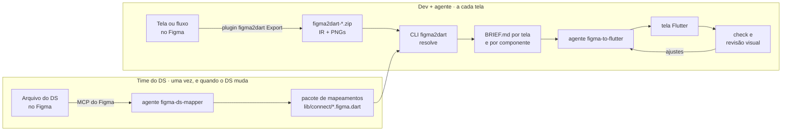

# figma_to_code

Transforma telas do Figma em código Flutter que **usa o Design System (DS)**: os widgets e os tokens que já
existem, em vez de `Container` com valores fixos. A parte determinística (qual widget, quais valores) sai pronta
de uma CLI; a LLM só decide o que o Figma não diz (ação de botão, dados de lista) e marca o que decidiu.

## Como funciona, em uma figura



1. **O time do DS anota o DS uma vez.** Cada componente do Figma ganha um `*.figma.dart`, que diz qual widget ele
   vira e como cada prop do Figma vira parâmetro. Um agente escreve isso lendo o Figma pelo MCP.
2. **O designer (ou o dev) exporta** a tela ou o fluxo com o plugin: um `.zip` com o JSON da tela (o IR) e os PNGs.
3. **A CLI resolve** a tela com os mapeamentos: o código de cada componente do DS já com os valores do Figma, o
   layout com tokens e o que falta decidir. Tudo num `BRIEF.md`.
4. **O agente implementa** a tela pelo brief, confere com o `check` e compara com o Figma na revisão visual.

Cada etapa, com entrada, saída e comandos: **[docs/COMO_FUNCIONA.md](docs/COMO_FUNCIONA.md)**.

## O que tem aqui

```
figma_to_code/
  figma_plugin/     plugin do Figma (TypeScript): exporta tela, fluxo, componente ou biblioteca no formato IR
  figma_connect/    pacote Flutter: a anotação @FigmaConnect, a captura para a revisão e o agente que anota o DS
  figma2dart/       CLI Dart: lê o export e os mapeamentos e escreve os briefs; agentes e skills de implementar telas
  docs/             como funciona, referências, guias e planejamento
```

Fora deste repositório, no `design_system/` (exemplo do POC, o **Carteira DS**):

```
design_system/
  carteira_design_system/   widgets e tokens do DS (a ferramenta nunca altera)
  carteira_ds_figma/        mapeamentos *.figma.dart do DS (depende do DS e do figma_connect)
  carteira_ds_examples/     exemplos de uso que compilam, citados nas anotações
  carteira_sample_app/      app de teste, com telas geradas pelo agente
```

## Começar

| Quero… | Leia |
|---|---|
| entender o fluxo inteiro | [docs/COMO_FUNCIONA.md](docs/COMO_FUNCIONA.md) |
| implementar telas num app | [figma2dart/README.md](figma2dart/README.md) (instalar, `init`, comandos) |
| exportar do Figma | [figma_plugin/README.md](figma_plugin/README.md) |
| anotar os componentes do DS | [figma_connect/README.md](figma_connect/README.md) e [docs/FIGMA_CONNECT.md](docs/FIGMA_CONNECT.md) |
| configurar o DS (tokens, ícones, retrato) | [docs/DESIGN_OPS.md](docs/DESIGN_OPS.md) |
| levar para o monorepo | [docs/MIGRACAO_MONOREPO.md](docs/MIGRACAO_MONOREPO.md) |
| achar qualquer outro doc | [docs/README.md](docs/README.md) |
