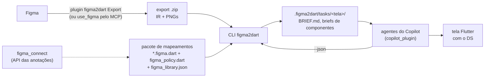

# Arquitetura

Como a solução é montada por dentro: as peças, o contrato entre elas (o IR), como a CLI acha as coisas e resolve
uma tela, e por que cada coisa é assim. O passo a passo de uso está em [COMO_FUNCIONA.md](COMO_FUNCIONA.md); a API
das anotações, em [FIGMA_CONNECT.md](FIGMA_CONNECT.md).

- [1. As peças](#1-as-peças)
- [2. O IR: o contrato com o Figma](#2-o-ir-o-contrato-com-o-figma)
- [3. Como a CLI acha as coisas](#3-como-a-cli-acha-as-coisas)
- [4. Como uma tela é resolvida](#4-como-uma-tela-é-resolvida)
- [5. Conferência: check, review e doctor](#5-conferência-check-review-e-doctor)
- [6. Agentes](#6-agentes)
- [7. Por que é assim](#7-por-que-é-assim)

---

## 1. As peças



| Peça | O que é | Pasta |
|---|---|---|
| Plugin do Figma | exporta tela, fluxo, componente ou biblioteca no formato IR (TypeScript, sem dependências) | `figma_plugin/` |
| IR | o contrato: JSON versionado, com schema gerado dos tipos | `figma_plugin/schema/ir.v1.schema.json` |
| `figma_connect` | pacote Flutter: `@FigmaConnect`, `FigmaProps`, `FigmaPolicy`, `figmaCapture` | `figma_connect/` |
| Pacote de mapeamentos | uma anotação por componente do DS, a política e o retrato do Figma; depende do DS e não o altera | `acme_figma/` (Acme), `carteira_ds_figma` (POC) |
| CLI `figma2dart` | tudo o que é determinístico: lê o export e os mapeamentos e escreve os briefs; confere o código | `figma2dart/` |
| Plugin do Copilot | agentes e skills que operam a CLI e escrevem o código | `copilot_plugin/` |

O TypeScript fica restrito ao plugin do Figma, porque o runtime de plugins do Figma é JavaScript. Tudo o que o time
Flutter mantém é Dart, JSON ou Markdown.

### Módulos da CLI

| Arquivo (`figma2dart/lib/src/`) | Responsabilidade |
|---|---|
| `workspace.dart` | pacote alvo, repositório, config, pacote de mapeamentos, exports, pasta das telas |
| `export.dart` | lê o `.zip` (ou `.json`) do plugin |
| `mappings.dart` | carrega as anotações e a política com o analyzer; escolhe o mapeamento de cada instância |
| `resolve.dart` | classifica cada camada e avalia as anotações com os valores da instância |
| `tokens.dart`, `icons.dart` | token e ícone do Figma → código Dart, pela política |
| `structure.dart`, `brief.dart` | estrutura da tela e o `BRIEF.md` |
| `component_brief.dart`, `api.dart`, `references.dart` | briefs de construção e de montagem, API do widget, docs e exemplos |
| `crop.dart` | recorte do PNG de cada instância |
| `hints.dart` | dicas do `check` (valor solto com token, texto ausente…) |
| `review.dart` | revisão visual: pares Figma × Flutter, fatos e critério |
| `coverage.dart` | cobertura da política contra o retrato (`doctor`) |
| `commands.dart` | os comandos (`doctor`, `screens`, `resolve`, `check`, `library`, `link`, `init`, `setup`, `packages`) |

---

## 2. O IR: o contrato com o Figma

Formato próprio e versionado (`irVersion` 1.4.0). Não usamos a saída do `get_design_context` do MCP: ela é código
de referência para LLM, não um contrato, e muda sem aviso. O schema completo é gerado de
`figma_plugin/src/extractor/ir.ts`.

```json
{
  "irVersion": "1.4.0",
  "kind": "screen",
  "source": { "via": "plugin", "extractor": "0.5.0", "fileName": "…", "pageName": "…", "exportedAt": "…" },
  "tokens": { "Spacing/lg": { "name": "lg", "collection": "Spacing", "type": "FLOAT", "value": 16 } },
  "textStyles": { "label": { "fontFamily": "Inter", "fontSize": 14 } },
  "componentRefs": { "<key>": { "name": "Button", "props": { "size": { "type": "VARIANT", "options": ["md", "sm"] } } } },
  "components": [],
  "screens": [ { "name": "Login", "states": [ { "state": "default", "tree": { } } ] } ],
  "flow": { "start": "7:135", "edges": [] },
  "lint": []
}
```

### 2.1 Tipos de export

O `kind` sai da seleção no Figma. O formato é o mesmo; muda o que vem preenchido.

| Seleção | `kind` | Traz |
|---|---|---|
| 1 frame | `screen` | a árvore da tela, as instâncias com props, os tokens usados, o PNG |
| 2+ frames ou uma section | `flow` | cada tela + a navegação do protótipo (`flow.edges`) |
| component set ou componente | `component` | todas as variants em profundidade, PNG de cada uma, `componentRefs` dos componentes de dentro |
| nada | `library` | os componentes da página, **todas** as variáveis e estilos de texto do arquivo |

Frames `Tela / estado` viram estados da mesma tela.

### 2.2 Profundidade

| Nó | Como entra |
|---|---|
| Instância de componente de biblioteca (remoto, ou local e publicado) | **rasa**: key, nome, props, instâncias expostas, overrides, conteúdo visível e a caixa na tela |
| Componente exportado, ou local não publicado usado na tela | **profundo** em `components`: árvore completa de cada variant |
| Frame de layout | completo: direção, gap, padding, sizing, limites, tokens |

Assim uma tela com 40 componentes do DS gera um export pequeno, e um componente novo um export detalhado. O critério
é o status de publicação, então um template montado dentro do arquivo do DS não arrasta os componentes do DS.

### 2.3 Nós e instâncias

Todo valor que veio de variável traz `token` (o nome, `Coleção/caminho`) **e** `value`. Os tokens são indexados por
`Coleção/nome` porque o mesmo nome pode existir em coleções diferentes (`Spacing/sm`, `Radius/sm`), e trazem o valor
de cada modo (Light/Dark).

Uma instância traz:

| Campo | O que é |
|---|---|
| `componentKey` | key do component set (ou do componente sem variants): por ela se acha a anotação |
| `mainComponentKey` | key da variant usada: acha uma anotação de uma variant só (cada ícone de um set `Icon`) |
| `props` | valores das props, com o nome exato do Figma (emoji incluso, sem o sufixo `#id`) |
| `exposed` | instâncias aninhadas expostas, em qualquer nível, cada uma com `path`, keys e `props` |
| `overrides` | o que mudou fora das props (texto, visibilidade, estilo, instância trocada), com os valores |
| `content`, `bounds` | numa tela: o que aparece dentro e a caixa relativa ao frame (para recortar o PNG) |

Na árvore de um componente (export em modo Componente), a instância aninhada exposta leva `exposedInstance: true`, e
cada variant traz a própria `key`.

### 2.4 Lint

O plugin aponta o que degrada a geração e leva até a camada: `raw-color`, `raw-spacing`, `raw-radius`,
`text-without-style`, `renamed-instance`, `detached-instance`, `style-override`, `missing-code-syntax`,
`absolute-layout`, `duplicate-name` (mesmo nome em duas bibliotecas: o segundo ganha o sufixo da key) e
`unresolved-alias` (variável que aponta para outra que o plugin não lê).

### 2.5 Pelo MCP

O `use_figma` do MCP do Figma roda a mesma Plugin API, então o mesmo extrator (`dist/mcp-extractor.js`) produz o
mesmo IR, sem imagens. O retorno do `use_figma` tem limite de 48 KB: quando o IR não cabe, o extrator devolve
páginas (`page`, `pages`) e o agente chama de novo com o mesmo `exportedAt`. A entrada principal é o `.zip` do
plugin: não custa tokens e funciona para quem não tem o MCP.

---

## 3. Como a CLI acha as coisas

Ninguém passa caminho para a CLI. Tudo parte da pasta de onde ela é chamada.

| O quê | Como |
|---|---|
| Comando `figma2dart` | `tool/figma2dart setup` grava um script em `~/.pub-cache/bin`. A cada chamada ele acha a CLI do repositório git atual pelo índice do git (`**/bin/figma2dart.dart`) e roda com `dart run` (executável em cache; o JSON sai limpo no stdout) |
| Pacote alvo | o `pubspec.yaml` mais próximo, subindo; ou `--package`. `figma2dart packages <texto>` lista os pacotes do repositório |
| Config do repositório | o `figma_to_dart.yaml` **versionado** que tem `mappings:` (pelo índice do git, onde estiver). Dois com `mappings:` é erro |
| Config do pacote | `figma_to_dart.yaml` no pacote, opcional; vence o do repositório (sem `mappings:`) |
| Pacote de mapeamentos | `mappings:` no config; senão, a dependência do pacote com `lib/figma_policy.dart`; senão, o único pacote do repositório com ela |
| Anotações | todo `lib/**/*.figma.dart` do pacote de mapeamentos, carregado com o analyzer (tipos e constantes resolvidos) |
| Exports | o `figma2dart-*.zip` mais novo em `exports:` (padrão `~/Downloads`) |
| Telas | `screens:` do config mais próximo: `.figma2dart/local.yaml` (o `--screens-dir`, fora do git), o do pacote ou o do repositório; relativo ao pacote. Widgets novos em `<screens>/widgets/` |
| Tarefas | `.figma2dart/tasks/<tela>/` no pacote (fora do git) |

Pacote sem `package_config` ganha `pub get` sozinho. O `doctor` mostra tudo o que foi achado e, para o que falta,
a correção.

---

## 4. Como uma tela é resolvida

O `resolve` carrega os mapeamentos uma vez e, para cada tela, percorre a árvore do IR.

### 4.1 Classificação de cada camada

Num lugar só (`resolve.dart`), a CLI decide o que cada camada vira:

| No IR | Vira |
|---|---|
| Instância com key no retrato do DS (sem retrato: instância remota) e com anotação | o código da anotação (`complete`, `partial`) ou `f2d:sketch` + brief de montagem |
| Instância do DS sem anotação | `f2d:gap` |
| Instância com `@FigmaLocal` no app (ou numa dependência direta) | `f2d:local` + brief de montagem |
| Instância fora do DS e sem `@FigmaLocal` | placeholder + brief de construção (`existing` se uma classe de mesmo nome já existe) |
| Componente com `_` ou `.` no começo do nome **sem** anotação própria, ou em `ignored` | não entra na tela (só do Figma) |
| Frame de layout | `Column`/`Row`/`Padding` na estrutura, com os tokens em Dart |
| Vetor, imagem, bloco desenhado à mão | placeholder ou `TODO(f2d)` |

O diagrama está em [COMO_FUNCIONA.md](COMO_FUNCIONA.md#do-ds-ou-fora-do-ds).

### 4.2 Qual anotação vale para a instância

1. Pela `mainComponentKey` (anotação de uma variant só); senão, pela `componentKey`.
2. Entre as anotações da mesma key, as que têm `when` compatível com as props; a mais específica vence. Empate é
   erro: a escolha seria por acaso.

### 4.3 Avaliar a anotação

A CLI não executa a anotação: lê o código dela (a AST) e troca cada `f.*` pelo valor da instância. O resto do
código fica como está.

| Chamada | Vira |
|---|---|
| `f.text`, `f.boolean` | o literal |
| `f.variant(prop, {…})` | **só o ramo escolhido**, avaliado de novo. Por isso o ramo pode ser um construtor nomeado, uma factory ou outro widget |
| `f.icon` | a constante do ícone, pela política (4.4) |
| `f.instance(path)` | o código da instância exposta, pela anotação dela |
| `f.nested(path).…` | as props de uma instância exposta, lidas pelo pai |
| `f.guided(parte, guide:, or:)` | o valor `or` com o marcador `f2d:guided`, e a decisão vai para o brief |
| `cond ? a : b` | só o lado que vale, se a condição é conhecida |

**Props das instâncias expostas.** `f.text('✏️ Type')` procura a prop no componente e, se não achar, nas instâncias
expostas, como o painel do Figma mostra. É o que permite uma anotação só para o componente público que expõe uma
base travada (`Button Icon` com `.Icon Button / Large`, `/ Medium`…, cada uma com a sua key). Se a prop existe em
duas expostas, a instância vira `f2d:gap` pedindo `f.nested(<caminho>)`.

Um valor sem correspondência (variant sem opção no mapa, prop que não existe) derruba só aquela instância, como
`f2d:gap` com o motivo; o resto da tela segue.

### 4.4 Tokens e ícones

Pela `FigmaPolicy` do pacote de mapeamentos ([FIGMA_CONNECT §7](FIGMA_CONNECT.md#7-política-por-tipo-figmapolicy)):

- **Token** `Coleção/caminho/nome` → classe pela coleção (`collections`) ou, se a coleção é a marca, pelo caminho
  mais longo em `scopes`; membro por `names`, pelo nome do Figma entre crases no doc do membro, ou em camelCase. Sem
  correspondência, o brief mantém o nome e o valor (`Spacing/huge (sem Dart, 48)`).
- **Ícone** → `byKey` pela `mainComponentKey`; senão, o nome do Figma em camelCase conferido contra o enum ou as
  constantes da classe. Sem correspondência, o primeiro valor com `TODO(f2d)`.

### 4.5 A saída

| Arquivo | Para quê |
|---|---|
| `BRIEF.md` | o que o agente lê: código de cada instância, estrutura da tela, navegação, decisões, norte e docs dos componentes, o que ficou fora |
| `resolved.json` | o mesmo em JSON |
| `components/<nome>/BRIEF.md` | brief de **construção** (fora do DS: onde criar, API proposta pelas props, estrutura com tokens, variantes, usos) ou de **montagem** (`sketch`/`local`: API do widget lida do código, dados e recorte de cada instância) |
| `check.json`, `review.json` | o que o `check` e a revisão esperam |

Os marcadores que a CLI escreve no código e quem resolve cada um: [COMO_FUNCIONA.md](COMO_FUNCIONA.md#marcadores-no-código).

---

## 5. Conferência: check, review e doctor

- **`check`** reprova só o que ficou por fazer: marcador `guided`, `gap`, `sketch` ou `local`, e erro do
  `dart analyze`. `placeholder`, `inferred` e `TODO(f2d)` só contam. O resto são **dicas** (`hints`): valor solto que
  tem token do mesmo valor, texto do Figma ausente, widget a montar que sumiu, parâmetro da API proposta ausente.
- **`review`** compara a captura da tela Flutter (`figmaCapture`, num teste de widget) com o PNG do Figma: um par de
  imagens por seção, pela caixa do Figma, e **fatos** sem pixel (texto ausente, fora de ordem, cortado, overflow). Não
  dá veredito: o subagente `figma-visual-reviewer` julga pelo critério do `REVIEW.md`.
- **`doctor`** diz o que a CLI achou e o que falta. Com o retrato (`figma_library.json`), confere também a política:
  quantos tokens, estilos de texto e ícones do Figma têm código Dart, e os que faltam agrupados com o que fazer.

O retrato é gravado por `figma2dart library` a partir de exports em modo biblioteca:

```json
{
  "pages": { "Acme / Buttons": { "components": { "<key>": "Button Icon" }, "icons": { "<key>": "arrow-up" } } },
  "files": { "Acme": { "tokens": ["MarcaA/Colors/Surface/01"], "textStyles": ["Body/sm"] } }
}
```

É ele que separa "componente do DS sem anotação" (`f2d:gap`, trabalho do time do DS) de "componente fora do DS"
(brief de construção).

---

## 6. Agentes

Os agentes operam a CLI pelo terminal, com `--json`, e escrevem o código. Ficam no plugin do Copilot
([copilot_plugin/](../copilot_plugin/), formato Agent Plugins 1.0), instalado uma vez por máquina.

| Agente | Faz | Skills |
|---|---|---|
| `figma-to-flutter` | orquestra a implementação de telas | `figma2dart-setup`, `figma2dart-screen`, `figma2dart-review` |
| `figma-component-builder` | subagente: constrói um componente fora do DS | `figma2dart-component` |
| `figma-visual-reviewer` | subagente: revisa a tela, só lê | — |
| `figma-ds-mapper` | escreve as anotações e a política do DS | `figma2dart-connect`, `figma2dart-policy`, `figma2dart-setup` |

O agente pergunta ao usuário só o que é escolha dele (qual tela, construir ou não um componente, qual widget quando
há dúvida). Os caminhos vêm sempre da CLI.

---

## 7. Por que é assim

| Decisão | Motivo |
|---|---|
| Mapeamento em Dart (`*.figma.dart`), não Code Connect | Code Connect é TypeScript e só aparece com Dev Mode. Em Dart, a anotação instancia o widget de verdade: mudar a API do DS quebra a compilação do pacote de mapeamentos |
| Pacote de mapeamentos separado | o DS não é alterado para atender a ferramenta |
| Identidade pela key, nunca pelo nome | renomear no Figma não quebra nada |
| IR próprio | um contrato estável entre o Figma e a CLI, que o plugin e o MCP produzem igual |
| Plugin como entrada principal | sem Dev Mode, sem custo de tokens, funciona para qualquer pessoa |
| A CLI nunca escreve a tela | o determinístico sai pronto; o que exige julgamento vai para a LLM com o norte da anotação, e ela marca o que decidiu |
| Informar, não bloquear | o `check` reprova só o que ficou por fazer; valor solto, texto ausente e afins viram dica, e a LLM decide |
| Uma anotação no componente público, com as props das bases pelo nome | a base travada é o mesmo widget; uma anotação por base seria duplicação |
| Sem golden nem pixel perfect | a captura muda com fonte e plataforma; a revisão pela LLM com fatos sem pixel acha o que uma pessoa notaria |
| CLI pelo terminal com `--json`, sem servidor MCP | funciona em qualquer agente que tenha terminal, sem registrar nada |
| Componente fora do DS vira brief de construção | construir é escolha do usuário; até lá fica um placeholder do tamanho do Figma |
| Retrato do DS versionado | sem ele não dá para separar "do DS sem anotação" de "fora do DS", nem conferir a política |
