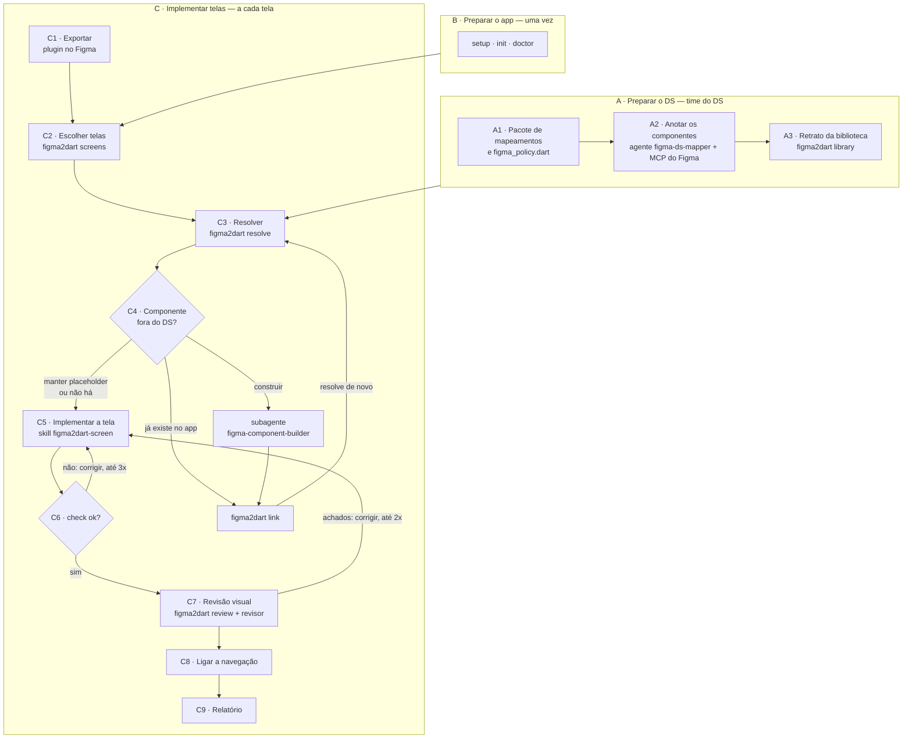
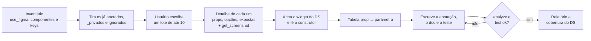
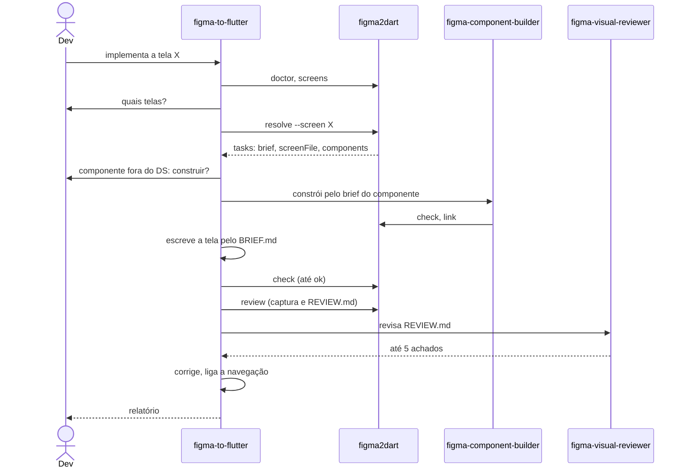
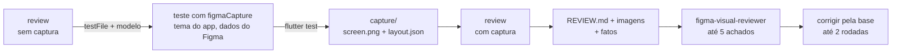
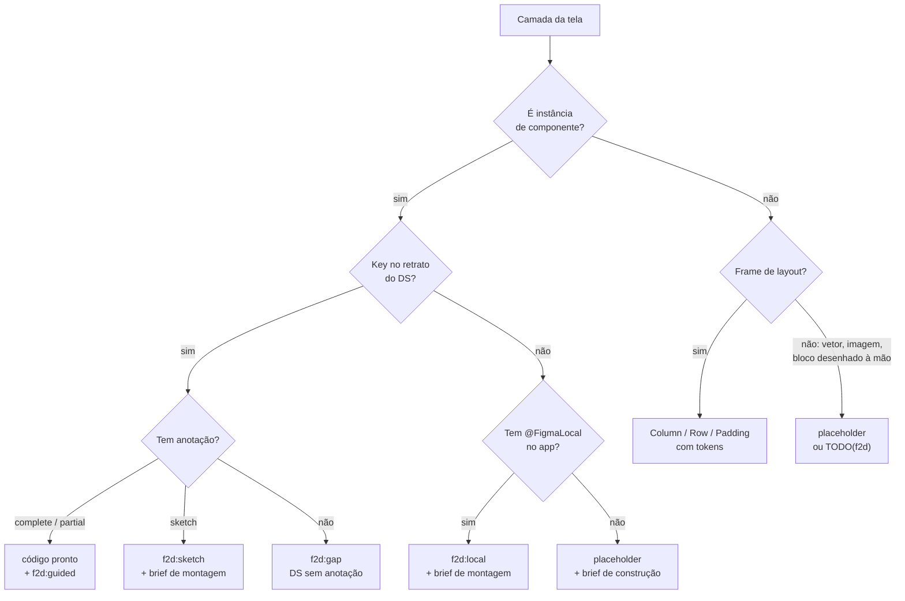

# Como funciona

O caminho completo de uma tela do Figma até o código Flutter, etapa por etapa: quem faz, o que entra, o que
acontece e o que sai. Para o porquê das decisões, veja [ARCHITECTURE.md](ARCHITECTURE.md); para a API das
anotações, [FIGMA_CONNECT.md](FIGMA_CONNECT.md).

- [Visão geral](#visão-geral)
- [A. Preparar o DS](#a-preparar-o-ds) (time do DS, uma vez e quando o DS muda)
- [B. Preparar o app](#b-preparar-o-app) (uma vez por app e por máquina)
- [C. Implementar telas](#c-implementar-telas) (a cada tela ou fluxo)
- [Do DS ou fora do DS: como cada camada é classificada](#do-ds-ou-fora-do-ds)
- [Marcadores no código](#marcadores-no-código)
- [Onde fica cada arquivo](#onde-fica-cada-arquivo)
- [Quem faz o quê](#quem-faz-o-quê)

---

## Visão geral

Três papéis, três momentos:

| Papel | Quando | Faz |
|---|---|---|
| **Time do DS** (design ops) | uma vez, e quando o DS muda | anota cada componente do DS (`*.figma.dart`), configura tokens e ícones, grava o retrato da biblioteca |
| **Designer** (ou o dev) | a cada tela | exporta a tela ou o fluxo com o plugin |
| **Dev + agente** | a cada tela | pede a tela ao agente, decide o que só ele sabe (construir ou não um componente) e revisa o resultado |



A CLI faz tudo o que é determinístico e nunca escreve a tela. O agente lê o que a CLI escreveu e escreve o código.
Nenhuma etapa bloqueia por estilo: o `check` reprova só o que ficou por fazer, e o resto vira dica.

---

## A. Preparar o DS

Feito pelo time do DS, no **pacote de mapeamentos** (no POC, `design_system/carteira_ds_figma`; no monorepo,
`acme_figma`). Passo a passo de cada item: [DESIGN_OPS.md](DESIGN_OPS.md).

### A1 · Pacote de mapeamentos e política

| | |
|---|---|
| **Quem** | time do DS (ou o agente `figma-ds-mapper`, que cria o pacote se não existir) |
| **Entrada** | o pacote do DS e o `figma_connect` |
| **Saída** | `pubspec.yaml` (DS + `figma_connect`), `lib/connect/`, `lib/figma_policy.dart`, `test/mappings_test.dart` |

O `figma_policy.dart` diz, para o DS inteiro:

- **tokens**: cada coleção de variáveis do Figma → a classe Dart dos tokens (`Spacing` → `DsSpacing`), para o brief
  já sair com `DsSpacing.md` em vez de `Spacing/md`;
- **ícones**: o enum de ícones do DS e as exceções por key;
- **ignorados**: componentes que só existem no Figma (além do prefixo `_` ou `.`);
- **regras por tipo** de componente (`component`, `section`, `template`, `icon`).

### A2 · Anotar os componentes

| | |
|---|---|
| **Quem** | agente [`figma-ds-mapper`](../figma_connect/agent/agents/figma-ds-mapper.agent.md), com a skill [`figma2dart-connect`](../figma_connect/agent/skills/figma2dart-connect/SKILL.md) |
| **Entrada** | a URL do arquivo do DS no Figma (lido pelo MCP do Figma, só leitura) e o código dos widgets do DS |
| **Saída** | por componente: `lib/connect/<widget>.figma.dart`, `docs/<widget>.md` (quando há parte guiada), linha no README do pacote e casos no `mappings_test.dart` |
| **Confere** | `flutter analyze` e `flutter test` no pacote |



Cada anotação liga a **key** do componente no Figma ao widget, e diz como cada prop vira parâmetro:

```dart
@FigmaConnect(key: 'f5c999bb…', name: 'Badge')
Widget badge(FigmaProps f) => DsBadge(
  label: f.text('label'),
  tone: f.variant('tone', {'success': DsBadgeTone.success, 'danger': DsBadgeTone.danger}),
);
```

A **cobertura** diz quanto a anotação resolve sozinha:

| Cobertura | Quando | Na tela vira |
|---|---|---|
| `complete` | o Figma bate com a API do widget | código pronto |
| `partial` | parte é decisão da tela (ação, linhas de uma lista) | código pronto + `f2d:guided` nas partes com norte |
| `sketch` | o conteúdo são camadas, não props (templates) | `f2d:sketch` + brief de montagem com a API do widget |

A key é sempre copiada do MCP, nunca digitada. Referência completa: [FIGMA_CONNECT.md](FIGMA_CONNECT.md).

### A3 · Retrato da biblioteca

| | |
|---|---|
| **Quem** | time do DS |
| **Entrada** | export do plugin em **modo biblioteca** (uma página do arquivo do DS, sem seleção) |
| **Comando** | `figma2dart library <zip>…` |
| **Saída** | `figma_library.json` no pacote de mapeamentos: key e nome de cada componente do DS |

O retrato é o que separa "componente do DS sem anotação" (vira `gap`, fila de trabalho do time do DS) de
"componente fora do DS" (vira placeholder e brief de construção). Sem retrato, vale a regra antiga: componente de
qualquer biblioteca remota conta como do DS.

---

## B. Preparar o app

| Passo | Comando | Faz |
|---|---|---|
| Instalar | `<pasta da CLI>/tool/figma2dart setup` | põe o comando `figma2dart` no PATH (uma vez por máquina) |
| Preparar o app | `figma2dart init` | cria o `figma2dart.yaml`, põe `.figma2dart/` no `.gitignore` e instala agentes e skills em `.github/agents/` e `.agents/skills/` |
| Conferir | `figma2dart doctor` | mostra o que a CLI achou (pacote, mapeamentos, retrato, exports, pasta das telas) e o que falta, com a correção |

O `figma2dart.yaml` é opcional; tudo o que falta a CLI descobre (pacote de mapeamentos pelas dependências, exports
em `~/Downloads`). Num monorepo, um config versionado na pasta da CLI vale para todos os pacotes:
[figma2dart/README.md#monorepo](../figma2dart/README.md#monorepo).

---

## C. Implementar telas

O dev pede ao agente `figma-to-flutter` ("implementa o fluxo de transferência do último export"). O agente roda a
CLI com `--json`, pergunta só o que é escolha do dev e segue as etapas abaixo.



### C1 · Exportar

| | |
|---|---|
| **Quem** | designer ou dev, no Figma desktop |
| **Ferramenta** | plugin **figma2dart Export** ([figma_plugin/README.md](../figma_plugin/README.md)) |
| **Saída** | `figma2dart-<tipo>-<nome>.zip` em `~/Downloads`: `export.json` (o IR) + PNGs |

O tipo sai da seleção: 1 frame é **tela**, 2 ou mais frames (ou uma section) é **fluxo**, com a navegação do
protótipo, um componente é **componente**, e nada selecionado é **biblioteca**. Frames `Tela / estado` viram
estados da mesma tela. O botão **Verificar** mostra o lint (camada sem auto layout, cor solta…) e leva até a camada.

O **IR** é o contrato entre o Figma e a CLI: a árvore da tela com layout, tokens pelo nome, instâncias com key e
props, a caixa de cada camada e o conteúdo das instâncias. O mesmo extrator roda pelo MCP (`use_figma`), sem
imagens. Formato: [ARCHITECTURE.md §4](ARCHITECTURE.md#4-ir-v1--o-contrato).

### C2 · Escolher o export e as telas

| | |
|---|---|
| **Comando** | `figma2dart screens [<zip>] --json` |
| **Saída** | as telas e os estados do export, na ordem do fluxo, com quantas instâncias ficam fora do DS |

Sem `<zip>`, a CLI usa o `figma2dart-*.zip` mais novo da pasta de exports. O agente confirma o export e pergunta
quais telas implementar.

### C3 · Resolver

| | |
|---|---|
| **Comando** | `figma2dart resolve [<zip>] --screen "<tela 1>" --screen "<tela 2>" --json` |
| **Entrada** | o export, os mapeamentos e o retrato do DS, e os `@FigmaLocal` do app |
| **Saída** | uma pasta por tela em `.figma2dart/tasks/<tela>/` (ver [Onde fica cada arquivo](#onde-fica-cada-arquivo)) |

Para cada tela, a CLI:

1. **Classifica cada camada** em do DS, do app ou fora do DS ([abaixo](#do-ds-ou-fora-do-ds)).
2. **Avalia cada anotação** com os valores daquela instância: `f.text('label')` vira `'Entrar'`,
   `f.variant(...)` vira o valor do enum, `f.guided(...)` vira o valor provisório com o marcador `f2d:guided`.
3. **Descreve a estrutura** da tela: frames com direção, gap, padding e alinhamento, já com os tokens em Dart.
4. **Junta o que a LLM precisa decidir**: a navegação do protótipo, as decisões (`f2d:guided`) com o norte, e os
   trechos dos docs e exemplos dos componentes usados.
5. **Escreve os briefs dos componentes**: um brief de construção para cada componente fora do DS (com dependências
   primeiro) e um brief de montagem para cada `sketch` e `local`, com a API do widget e o recorte do PNG de cada
   instância.
6. **Grava o que vai ser conferido depois**: `check.json` (textos e widgets esperados) e `review.json` (tamanho do
   frame e seções, para a captura).

Exemplo do que sai no brief para o campo de senha do Login:

```dart
DsInput(
  label: 'Senha',
  errorText: 'Senha incorreta. Tente novamente.',
  leadingIcon: DsIconName.lock,
  obscureText: /* f2d:guided G4 obscureText */ false,
)
```

### C4 · Componentes fora do DS

Para cada componente da tela que não está no DS (`"kind": "build"` no JSON), o agente pergunta ao dev, um por vez:

| Escolha | O que acontece |
|---|---|
| **Já existe no app** (a CLI achou uma classe com o mesmo nome, `existing`, ou o dev indica o arquivo) | `figma2dart link <key> <arquivo>#<Classe>` escreve um `@FigmaLocal` em `figma/connect/` do pacote |
| **Construir** | o subagente `figma-component-builder` cria o widget em `<telas>/widgets/` pelo brief de construção (skill [`figma2dart-component`](../figma2dart/agent/skills/figma2dart-component/SKILL.md)), com teste, `check` e, no fim, o `link` |
| **Manter placeholder** | fica um `Placeholder` do tamanho do Figma, pendência do dev |

Depois de um `link`, o agente roda o `resolve` daquela tela de novo e o componente passa a `local` (montado como
widget do app). A decisão fica gravada no código, então nenhuma tela pergunta de novo sobre o mesmo componente.

### C5 · Implementar a tela

| | |
|---|---|
| **Quem** | agente `figma-to-flutter`, com a skill [`figma2dart-screen`](../figma2dart/agent/skills/figma2dart-screen/SKILL.md) |
| **Entrada** | o `BRIEF.md`, o PNG da tela e os componentes construídos |
| **Saída** | o `screenFile` (padrão `lib/figma/<tela>_page.dart`) |

O agente copia o código das instâncias como está, monta o layout da estrutura com os tokens, troca cada marcador
pela decisão (e apaga o marcador), monta os `sketch` e `local` pela API do brief deles e marca com `f2d:inferred`
tudo o que decidiu sem base no brief. Nunca usa cor, tamanho ou espaçamento solto.

### C6 · Conferir

| | |
|---|---|
| **Comando** | `figma2dart check <screenFile> <widgets construídos> --json` |
| **Reprova** | marcador que sobrou (`guided`, `gap`, `sketch`, `local`) ou erro do `dart analyze` |
| **Só conta** | `placeholder`, `inferred`, `TODO(f2d)` |
| **Dicas** (`hints`, não reprovam) | valor solto que tem token (`EdgeInsets.all(12)` → `DsSpacing.md`), texto do Figma que não aparece, widget a montar que sumiu, parâmetro da API proposta ausente |

O agente corrige até `"ok": true`, em no máximo 3 rodadas. Cada dica ele corrige ou explica com
`// f2d:inferred — <motivo>` na linha.

### C7 · Revisão visual

| | |
|---|---|
| **Quem** | agente, com a skill [`figma2dart-review`](../figma2dart/agent/skills/figma2dart-review/SKILL.md), e o subagente `figma-visual-reviewer` (só lê) |
| **Comandos** | `figma2dart review --screen <tela>`, `flutter test <teste de captura>` |
| **Saída** | `review/` na pasta da tarefa: `screen.png` (Figma \| Flutter), um par de imagens por seção, `facts.json` e `REVIEW.md` |



Não é pixel perfect. A CLI calcula **fatos** que não dependem de pixel (texto ausente, fora de ordem, cortado,
overflow) e o revisor compara as imagens pelo critério do `REVIEW.md`: importa o que uma pessoa notaria
(elemento faltando, ordem, cor, ícone errado); fonte, serrilhado e diferença de 1 a 3 px são ignorados. Todo
achado precisa de base no brief. O teste de captura fica no repositório: sem `.figma2dart/` (CI, outra máquina),
ele passa sem capturar.

### C8 · Ligar a navegação

As telas saem na ordem do fluxo, então o botão que leva a uma tela ainda não escrita fica com ação vazia e
`// f2d:inferred — tela <nome> ainda não existe`. Depois de todas as telas, o agente procura esse texto e troca
pela navegação até a tela de destino, com o mecanismo que o app já usa.

### C9 · Relatório

Por tela: o arquivo escrito, os componentes construídos, os placeholders que ficaram, cada `f2d:inferred` com o
motivo, os `TODO(f2d)` (ícone ou imagem para o dev trocar), as dicas e os achados da revisão que ficaram, e o
`review/screen.png` para o dev conferir.

---

## Do DS ou fora do DS

A CLI decide, num lugar só, o que cada camada da tela vira:



Componentes com nome começando em `_` ou `.` (anotações do designer, bases) e os `ignored` do `FigmaPolicy` não
entram na tela. Tabela completa: [ARCHITECTURE.md §10.5](ARCHITECTURE.md#105-marcadores-no-código).

---

## Marcadores no código

Comentários que a CLI escreve e o agente resolve. O `check` usa esses marcadores para saber o que falta.

| Marcador | Significa | Resolve | No `check` |
|---|---|---|---|
| `f2d:guided Gn <parte>` | decisão com norte (ação, acessibilidade, dados) | agente | reprova |
| `f2d:gap` | componente do DS sem anotação, ou prop sem leitura | agente, com o widget mais próximo | reprova |
| `f2d:sketch` | componente do DS para montar pela API | agente | reprova |
| `f2d:local` | widget do app para montar pela API | agente | reprova |
| `f2d:placeholder` | fora do DS e não construído | dev | só conta |
| `f2d:inferred` | decisão sem base no brief, para o revisor conferir | revisor humano | só conta |
| `TODO(f2d)` | ícone que não existe no DS, imagem ou vetor sem arquivo | dev | só conta |

---

## Onde fica cada arquivo

**No app** (versionado):

```
<pacote do app>/
  figma2dart.yaml                     config (opcional)
  .github/agents/  .agents/skills/    agentes e skills (figma2dart init)
  lib/figma/<tela>_page.dart          telas escritas pelo agente
  lib/figma/widgets/<componente>.dart componentes construídos
  figma/connect/<componente>.figma.dart  @FigmaLocal: componente do Figma → widget do app (figma2dart link)
  test/figma/…                        testes das telas (captura) e dos componentes
```

**Na pasta de trabalho** (`.figma2dart/`, fora do git), por tela:

```
.figma2dart/tasks/<tela>/
  BRIEF.md            o que o agente lê: código das instâncias, estrutura, navegação, decisões, regras
  resolved.json       o mesmo em JSON
  check.json          o que o check espera (textos, widgets a montar)
  review.json         tamanho do frame e seções, para a captura
  images/screens/     PNG da tela no Figma
  components/<nome>/  brief de construção ou de montagem: BRIEF.md, component.json, recorte de cada instância
  capture/            screen.png + layout.json (gravados pelo teste de captura)
  review/             screen.png (Figma | Flutter), sections/, facts.json, REVIEW.md
```

**No pacote de mapeamentos do DS** (versionado):

```
<ds>_figma/
  lib/connect/<widget>.figma.dart   uma anotação por componente do DS
  lib/figma_policy.dart             tokens, ícones, ignorados, regras por tipo
  docs/<widget>.md                  doc para a LLM (quando há parte guiada)
  figma_library.json                retrato da biblioteca (figma2dart library)
  test/mappings_test.dart           cada anotação com todas as opções de variant
  .github/agents/  .agents/skills/  agente figma-ds-mapper e skill figma2dart-connect
```

---

## Quem faz o quê

| Peça | Tipo | Onde está | Usado em |
|---|---|---|---|
| figma2dart Export | plugin do Figma | [figma_plugin/](../figma_plugin/) | C1, A3 |
| `figma2dart` | CLI Dart | [figma2dart/](../figma2dart/) | B, C2–C7, A3 |
| `figma_connect` | pacote Flutter: anotações e `figmaCapture` | [figma_connect/](../figma_connect/) | A, C7 |
| `figma-ds-mapper` | agente (time do DS) | [figma_connect/agent/agents/](../figma_connect/agent/agents/) | A1, A2 |
| `figma2dart-connect` | skill: anotar um componente | [figma_connect/agent/skills/](../figma_connect/agent/skills/) | A2 |
| `figma-to-flutter` | agente orquestrador (dev) | [figma2dart/agent/agents/](../figma2dart/agent/agents/) | C |
| `figma-component-builder` | subagente: constrói um componente | idem | C4 |
| `figma-visual-reviewer` | subagente: revisa a tela, não edita | idem | C7 |
| `figma2dart-setup` | skill: resolver o que o `doctor` aponta | [figma2dart/agent/skills/](../figma2dart/agent/skills/) | B, C |
| `figma2dart-screen` | skill: escrever a tela pelo brief | idem | C5 |
| `figma2dart-component` | skill: construir um componente | idem | C4 |
| `figma2dart-review` | skill: captura, review e correções | idem | C7 |
